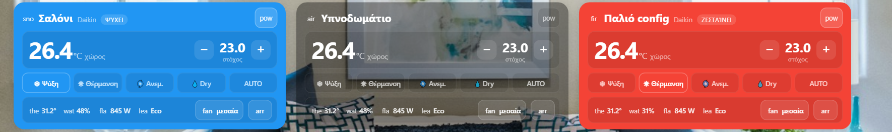

# Clima Card

Συμπαγής κάρτα **κλιματιστικού** για το Home Assistant: το φόντο παίρνει το χρώμα της λειτουργίας (ψύξη, θέρμανση, αφύγρανση, ανεμιστήρας, auto), μεγάλη θερμοκρασία χώρου, στόχος με +/−, κουμπιά λειτουργιών, ανεμιστήρας, περσίδες, εξωτερική θερμοκρασία, υγρασία, κατανάλωση, Eco και χρονοδιακόπτης.

*Compact A/C card: mode-coloured background, indoor and target temperature, HVAC modes, fan and swing, outside temperature, humidity, power, eco and timer. Full visual editor.*



## Εγκατάσταση
**HACS:** ⋮ → Custom repositories → `https://github.com/stathisktm/clima-card`, τύπος **Dashboard** → Download.
**Χειροκίνητα:** αντέγραψε το `clima-card.js` στο `/config/www/` και πρόσθεσε πόρο `/local/clima-card.js` (JavaScript module).

## Ρύθμιση
Από τον **οπτικό editor** (επιλογή οντοτήτων, ενότητες Αισθητήρες / Εμφάνιση / Χρώματα) ή σε YAML:
```yaml
type: custom:clima-card
title: Σαλόνι
subtitle: Daikin
entity_climate: climate.salon
entity_indoor_temp: sensor.salon_temperature      # αλλιώς η θερμοκρασία του κλιματιστικού
entity_indoor_humidity: sensor.salon_humidity     # αλλιώς η υγρασία του κλιματιστικού, αν τη δίνει
entity_outside_temp: sensor.outside_temperature
entity_power_consumption: sensor.ac_power
entity_eco: switch.ac_eco
entity_timer: timer.ac
```
Επιλογές εμφάνισης: `show_mode_cool/heat/fan/dry/auto`, `show_fan_speed`, `show_power_consumption`, `theme`, `image_url`.

### Ώρες λειτουργίας (σήμερα / μήνας)
`show_runtime_today: true` και `show_runtime_month: true` (ή οι δύο διακόπτες στον editor). Εμφανίζονται στην κάτω γραμμή, οπότε η κάρτα **δεν μεγαλώνει**. Δεν χρειάζεται κανένας νέος αισθητήρας: ο χρόνος βγαίνει από το ιστορικό του ίδιου του κλιματιστικού, όσο ήταν σε οποιαδήποτε κατάσταση εκτός από `off`.

Το ιστορικό κρατιέται μόνο όσες μέρες λέει το `recorder` (`purge_keep_days`). Γι' αυτό η κάρτα κρατά και ένα μικρό ημερήσιο «τετράδιο» στα δεδομένα χρήστη του HA (`frontend/set_user_data`, ίδιο σε όλες τις συσκευές του ίδιου χρήστη) και συμπληρώνει τις μέρες που λείπουν κάθε φορά που ανοίγει. Αν δεν ανοίξει καθόλου για περισσότερες μέρες από όσες κρατάει το ιστορικό, ο μήνας φαίνεται με «≥» (τουλάχιστον). Χρώματα: `color_cool/heat/dry/fan/auto/off`.

## Αλλαγές
- **2.1.0:** ώρες λειτουργίας σήμερα και μήνα (προαιρετικές, χωρίς νέο αισθητήρα, χωρίς αλλαγή μεγέθους). Η ένδειξη «ΨΥΧΕΙ/ΖΕΣΤΑΙΝΕΙ» γράφεται πλέον χωρίς τόνους.
- **2.0.0:** κανονικός οπτικός editor με επιλογή οντοτήτων. Δείχνει μόνο τις λειτουργίες που υποστηρίζει το κλιματιστικό, και το AUTO δουλεύει με `auto` ή `heat_cool`. Τα +/− μαζεύουν τα πατήματα και στέλνουν μία εντολή. Νέα ένδειξη «ψύχει / ζεσταίνει», όνομα ταχύτητας ανεμιστήρα, οι περσίδες κρύβονται αν δεν υπάρχουν, timer με αντίστροφη μέτρηση, πάτημα σε κάθε τιμή για λεπτομέρειες, διόρθωση του παλιού κλειδιού `null` στην υγρασία. Η αρχική έκδοση υπάρχει στο πρώτο commit.

## Άδεια
[MIT](LICENSE)
